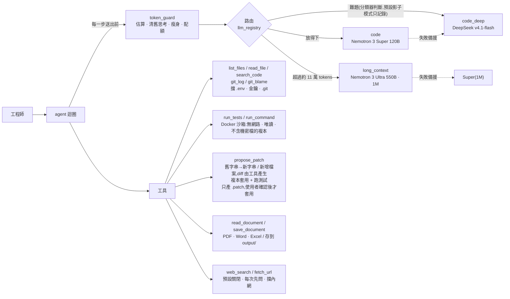

# 對內研發助理 — NVIDIA NIM 多模型 Agent

企業內部的程式碼助理(找 bug、提修正、寫技術文件)。考量程式碼隱私,不接雲端 Claude / GPT,
改走 NVIDIA 生態系:開發期接 API Catalog(build.nvidia.com),正式環境換成地端 NIM 容器,**程式碼不用改**。

重點不在「接上了模型」,而在:**依任務與 token 數動態切換模型、控制 token 與顯存、讓 agent 只能在沙箱裡動手**,
而且每個設計都用真模型實測過。實測與審查抓到 29 個問題,見下方。

## 架構



| 檔案 | 內容 |
|---|---|
| `models.yaml` | 模型註冊表。換模型、換 catalog / 地端都只改這裡 |
| `llm_registry.py` | 依角色建模型、備援鏈、依 token 數路由 |
| `difficulty.py` | 依難度選模型:每輪先請 Super(關思考)判斷一般 / 難題,難題改用 DeepSeek;分類器只看問題、上一輪摘要和附檔名稱,失敗就照預設;每輪記一行到 `output/routing_log.jsonl` |
| `report_routing.py` | 讀上面的紀錄產生報表:判斷分布、分類器成本、各模型實際步數 / tokens / 秒數、判斷為難題的題目給人工抽查 |
| `agent.py` | agent 迴圈:每步送出前清舊思考 → 瘦身 → 放不下就升級模型 → 檢查配額;`AgentSession` 支援多輪互動 |
| `token_guard.py` | token 估算(實測校準)、截斷、歷史瘦身、大檔大綱、每人配額 |
| `tools.py` | 列檔 / 讀檔 / 搜尋 / git 紀錄 / 沙箱測試與指令 / 提 patch / 存文件,含機密檔封鎖 |
| `documents.py` | PDF / Word / Excel 轉文字,給 `read_document` 和 `@附檔` 用 |
| `webui.py` + `webui.html` | 網頁介面:標準函式庫的 HTTP 伺服器 + Server-Sent Events,只聽 127.0.0.1,API 要帶啟動時產生的 token;側邊欄(新增 / 成品 / 待命 / 自訂 / 更多 + 專案和對話,左上角切換「對話 / 程式」,左下角帳號選單),對話存在 `output/state/` |
| `desktop_app.py` | 桌面版:背景啟動 webui(port 8780)+ Edge app 模式開獨立視窗,視窗都關了就結束;`--install` 建桌面捷徑,圖示 `assets/` 用純 Python 畫;「更多 → 手機」打開手機連線(QR code + PIN 配對) |
| `qr.py` | QR code 產生器(標準函式庫):手機連線的網址畫成 QR code |
| `ml/` + `train_models.py` | 自己訓練的小模型(照課程教材寫):ID3 決策樹判斷題目難不難、線性回歸預估每一輪的 tokens 和時間,跟 scikit-learn 的決策樹 / 邏輯回歸 / 隨機森林 / 神經網路比較;執行時讀 JSON,純 Python |
| `deploy/` | 多人部署:Dockerfile + docker-compose(小助理 `--team` + Redis + oauth2-proxy),說明見 `deploy/README.md` |
| `vscode-extension/` | VS Code 外掛:編輯器旁邊打開小助理、右鍵「問選取的程式碼」;`build_vsix.py` 打包成 .vsix(不需要 Node) |
| `web.py` | 上網搜尋(Tavily)與讀網頁;`.env` 設 `ALLOW_WEB=true` 才啟用,每次上網都先問使用者 |
| `smoke_test.py` | 對 catalog 上每個模型做冒煙測試(回應、思考開關、tool calling) |

## 實測結果(2026-10-06,NVIDIA API Catalog 免費層)

| 路徑 | 情境 | 結果 |
|---|---|---|
| 模型冒煙測試 | 三顆模型 × 回應 / 開思考 / 關思考 / tool calling | 全過;Super 每次 0.4–2.6 秒,DeepSeek 18–27 秒 |
| 改 bug | `demo_workspace/`:加號寫成減號 | Super 7 步、1.6 萬 tokens;兩次 diff 格式錯被退回後自行修正,沙箱實測 2 passed,原檔未動 |
| 長文本 | 客服專案 57 個檔案、19.1 萬 tokens,寫整份技術文件 | 自動升級到 Ultra,1 步完成,**482 秒**;抽查 14 處 `path:line` 引用全對 → [`demo_output/helpdesk-tech-doc.md`](demo_output/helpdesk-tech-doc.md) |
| 難度分類器(10/9) | 14 題示範問題(一般 7、難題 7,含「繼續」「好」這種要看前文的短回覆) | 14/14 符合預期;Super 關思考每次 0.6–1.1 秒、約 300 tokens。題目是自己出的,真實準確度要看影子模式的紀錄 |
| 看圖(10/9) | 錯誤截圖、長條圖、1 MB 的 JPEG,先轉文字再交給 Super | Nano Omni 關思考每張 1.4–9 秒、300–2,300 tokens,檔名 / 行號 / 數字 / 逐行抄寫全對;Super 依說明答對原因和修法 |
| 離線測試 | 假模型,不需金鑰 | 117 個全過 |

## 實測與審查抓到的 34 個問題

| # | 問題 | 怎麼發現 | 處理 |
|---|---|---|---|
| 1 | 指定的 `deepseek-v3`、`qwen2.5-coder-32b` 已從 catalog 下架 | 逐一探測 API 端點 | 改用現役版本;Qwen 標為只能地端 |
| 2 | `ChatNVIDIA` 預設輸出上限只有 1024 tokens,寫程式會被截斷 | 讀套件原始碼 | 每個角色明確設定 |
| 3 | 套件會把推理內容原樣回送伺服器,多輪對話會滾雪球 | 讀套件原始碼 | 每步清掉上一輪以前的推理;同一輪(單次任務)內保留,模型接著 tool call 推理需要,改由 token 預算控管 |
| 4 | Ultra 收到 `force_nonempty_content` 會把推理混進回答 | 冒煙測試 + 對照實驗 | Ultra 不送此參數;另清除孤立的 `</think>` |
| 5 | DeepSeek 連一句話都要 20 秒 | 冒煙測試計時 | 日常主腦改 Super,DeepSeek 留給難題 |
| 6 | agent 無法驗證自己的修正,最後**自己編了測試結果** | 端到端實測 | `propose_patch` 改在複本上套用並跑測試、回傳真實結果 |
| 7 | `.env` 裡的工作目錄設定被忽略 | 準備實測時 | 讀完 `.env` 再設定工具 |
| 8 | `read_file` 擋不住 `.env`,金鑰可能被送出去 | 指向真實專案前檢查 | 封鎖 `.env`、金鑰、憑證、`.git/` |
| 9 | 檔案已全附上,模型仍分段重讀,每步重送 18 萬 tokens | 長文本實測 | 整檔模式不給工具 |
| 10 | token 估算低估約 20%(估 15.3 萬,實際 18.3 萬) | 長文本實測 | 公式重新校準;執行中依實際用量自動修正 |
| 11 | 配額只在開始時檢查,跑到一半可遠超額度 | 長文本實測 | 每一步都檢查 |
| 12 | 工具定義(約 700 tokens)沒算進估算,被誤判成估算偏低,之後每步 ×1.99,中型任務會提早升級到 Ultra | 改 bug 實測 log(10/8) | 工具定義算進估算,不拿來放大倍率 |
| 13 | 模型回的 tool call 參數不是合法 JSON 時,被當成最終答案、回傳空字串 | 程式碼審查 + 讀套件原始碼 | 錯誤回給模型修正重送 |
| 14 | 模型手寫 unified diff 常格式錯,每次被退回多花 2–3 步(10/8 一次 8 步、2.1 萬 tokens) | 改 bug 實測 | 改成給「舊字串 → 新字串」,diff 由工具產生;同一題變 4 步、8 千 tokens |
| 15 | `models.yaml` 的上下文長度是 catalog 的值(Ultra 1M),地端預設 256K;切到 nim 時路由以為放得下,送出才被拒 | 程式碼審查 | 角色可另寫 `nim_context_window`,`LLM_BACKEND=nim` 時自動套用 |
| 16 | `search_code` 會跟著 symlink / Windows junction 讀到工作區外的檔案(`read_file` 有擋) | 程式碼審查 + 本機重現(一般帳號就能建 junction) | 依實際位置檢查,工作區外與機密檔一律略過 |
| 17 | 「修 bug + 新增回歸測試檔」時,模型以為 patch 會疊加,先單獨修 bug、再單獨送測試檔,測試失敗多繞好幾步(11 步、4.8 萬 tokens) | 新增檔案實測(10/9) | 工具回傳時明確提醒每個 patch 單獨驗證;同一題重跑變 7 步、2.2 萬 tokens |
| 18 | `run_tests` 直接掛載整個工作區,`.env` 在沙箱裡讀得到;複本的排除清單也漏了 `.env.staging` 這類檔名 | 加 `run_command` 前審查 | 沙箱一律掛排除機密檔的複本,判斷跟 `read_file` 同一套;指到工作區外的連結也不複製 |
| 19 | 沙箱逾時只停掉 docker CLI,容器在背景繼續跑;Windows 上沙箱輸出的中文變亂碼 | 程式碼審查 + 本機實測 | 容器加名字、逾時就 `docker kill`;輸出一律用 UTF-8 解碼 |
| 20 | 模型不知道今天幾號:摘要會議紀錄時把「下週三」算成 10/16(正確是 10/14) | 多功能互動實測(10/9) | 系統提示帶今天日期與星期(台北時間);重問一次答對 |
| 21 | 串流模式下套件只把工具呼叫放在 `tool_call_chunks`,送回伺服器時 AI 訊息沒有 tool call,下一步 ToolMessage 對不到 | 加串流前讀套件原始碼 | 串流結束後用 `as_complete_message` 補回 `additional_kwargs["tool_calls"]`;真模型 3 步工具呼叫正常 |
| 22 | 照計畫一步一步改時,每個 patch 各自對原始檔案驗證,模型讀檔一直看到舊內容,原地打轉到步數上限 | 規劃模式實測(10/9) | 改成「草稿」:修改累積,讀檔 / 搜尋 / 沙箱都看草稿版本,patch 是累積的;使用者套用或捨棄才結束 |
| 23 | 執行計畫時模型單獨呼叫 update_plan,15 步裡約 6 步只在更新進度,做到一半就停(13.2 萬 tokens) | 規劃模式實測(10/9) | 要求跟下一個動作一起呼叫、計畫限 3–6 步、執行模式上限 25 步;同一題重跑 12 步全部完成(9.4 萬 tokens) |
| 24 | 草稿、patch 紀錄、上網確認都是全程式共用的變數:多人同時用會看到別人的草稿,上網確認也會跳到別人畫面 | 做多人模式前審查 | 改成每人一個 `Workbench`(ContextVar),每個使用者的執行緒各自設定;測試確認兩人互相看不到 |
| 25 | 容器裡時區是 UTC,patch 檔名的時間差 8 小時;唯讀掛進來的 repo 擁有者不同,git 會拒絕(dubious ownership) | Docker 實測 | 映像設 `TZ=Asia/Taipei`(裝 tzdata)、`git config --system safe.directory '*'` |
| 26 | 難度分類器把「test_add 失敗了,找出 bug」判成難題(這題 Super 7 步就修好);開成 on 的話,最常見的改 bug 請求都會丟給慢約 10 倍的 DeepSeek | 分類器實測(10/9) | 判斷標準改成「單一測試或錯誤訊息」算一般、「跨多個檔案且沒有頭緒」才算難題;同 14 題重跑全部符合預期 |
| 27 | 從 GitHub 加專案用一般的 `git clone`,會自動用電腦上存的 GitHub 登入(系統的 Git Credential Manager、gh 設的 helper):私人 / 公司 repo 會被抓下來,再送到 build.nvidia.com | 做 GitHub 下載前實測(10/9,本機要求帳密的假伺服器 + 會留記號的假 helper:兩個都被叫到) | clone 時清掉 credential helper 和 askpass、關掉終端機提示;同一個實驗兩個 helper 都沒被叫到,私人 repo 0.5 秒就失敗 |
| 28 | 下載的 repo 自帶 `ASSISTANT.md` 的話會直接進系統提示:別人寫的內容被當成「團隊規則」照做 | 做 GitHub 下載時審查 | 下載的專案規則改存在 repo 外面(`output/repos/<名稱>.rules.md`),repo 自帶的那份只是一般檔案 |
| 29 | 影子模式也在回答前同步問分類器:每題多等約 1 秒、伺服器卡住最多 20 秒,答案卻不會變(影子模式只記錄) | 審查(10/9) | 影子模式改在背景判斷、這一輪不等它,判斷完才補寫紀錄;只有 `on` 會等結果 |
| 30 | 課程範例的線性回歸 `predict` 用「要預測的那批資料」自己的平均和標準差標準化:一次只預測一筆時(小助理一題一題預估)標準差是 0、平均也沒減掉,結果是錯的 | 把課程程式接進小助理時讀程式碼 | `ml/regression.py` 改用訓練時記下的平均和標準差;測試確認一次預測一筆和整批結果一樣 |
| 31 | 手寫 ID3 決策樹判斷難易,交叉驗證準確率 0.66,比「全部猜一般」的 0.68 還差 | 決策樹實驗(10/9,73 題 Super 標註的範例) | 特徵照分類器自己的判斷標準補上「間歇發生」「沒有頭緒 / 上次修正沒用」;加樹的深度實驗(1–6,交叉驗證挑):深度 5 準確率 0.89、F1 0.81 |
| 32 | 模型清單 API 列出的看圖模型,Phi-3 Vision、Cosmos Reason2 實際呼叫是 404;Llama 3.2 90B Vision 把檔名講錯、Gemma 4 31B 兩題都逾時 | 接看圖模型前逐一實測(10/9) | 選實測全對的 Nemotron 3 Nano Omni,備援 Llama 3.2 11B Vision(看得懂但行號會錯);冒煙測試加「看圖」一項(只送一張純紅色的小圖) |
| 33 | 免費層的 Nano Omni 約一半回 503(ResourceExhausted),一次就放棄的話常常看不到圖 | 實測(10/9) | 看圖模型先重試 2 次(每次等 1–3 秒)再換備援;都失敗也照樣回答,並告訴主模型有一張圖沒看到 |
| 34 | 看圖說明偶爾把同一段描述重複好幾次:一張圖 22 秒、3,800 tokens | 完整流程實測(10/9) | 提示改成三段、寫完就停,圖表數字和標籤要配對;temperature 0.2、輸出上限 1024;一模一樣的段落只留一次。重跑後每張 3–9 秒、約 700 tokens |

## 執行

```bash
python -m venv .venv && .venv/Scripts/pip install -r requirements.txt
cp .env.example .env                              # 填 NVIDIA_API_KEY,AGENT_WORKSPACE 指向要分析的 repo
docker build -t dev-assistant-sandbox sandbox     # 測試沙箱(含 pytest)
.venv/Scripts/python desktop_app.py --install     # 桌面版:在桌面建立「HSUAN」捷徑,雙擊就開獨立視窗(像 Claude 桌面版)
                                                  # 手機:「設定 → 手機」打開手機連線,手機掃 QR code、輸入 PIN,再「加到主畫面」就像 app
                                                  # (配對過的手機會記住;電腦上的小助理要開著,手機和電腦要同一個 Wi-Fi)
                                                  # 給別人用就給「訪客 PIN」:訪客有自己的空間,看不到你的對話和專案,每天 20 萬 tokens
                                                  # 左下角顯示今天用了多少 tokens(存在 output/state/usage.json,重開不歸零)
.venv/Scripts/python webui.py                     # 網頁介面(只開在本機):回答邊產生邊顯示,套用 / 上網前用按鈕確認
                                                  # 側邊欄:新增 / 成品(文件、patch)/ 待命(等你處理的草稿、確認、計畫)/ 自訂 / 更多,
                                                  # 下面是專案和它們的對話(自動存檔,關掉再開還在)
                                                  # 左上角切換「對話 / 程式」:對話模式不綁專案(一般問答、寫作、翻譯,只有上網和存文件的工具)
                                                  # 左下角帳號選單:設定(Ctrl+,)、回答語言、使用說明、更新紀錄、了解更多;手機上可以登出
                                                  # 輸入框右下角選模型和「努力程度」(低 / 中 / 高 / 超高:思考開關、步數上限、要多仔細)
                                                  # 輸入框的「+」上傳圖片(或貼上、拖進來):先用 Nemotron Nano Omni 把圖轉成文字再回答
                                                  # 「新增專案」可以貼公開的 GitHub 網址(下載到 output/repos/,只抓公開的);
                                                  # 開了上網的話,對話裡貼 PR / issue / 檔案網址,會讀成純文字(PR 附 diff)
.venv/Scripts/python webui.py --lan               # 不用桌面版時:同一個 Wi-Fi 的手機也能開,終端機印出網址和 6 位數 PIN(不要和桌面版同時開)
.venv/Scripts/python agent.py                     # 互動模式:一直聊下去,記得前面的內容;@calc.py 附檔、/clear 新對話
                                                  # 修改先放在小助理的草稿上;通過沙箱測試後會問要不要套用,回答 y 才改工作區
                                                  # /plan 任務:先只讀不改交出計畫,同意後照計畫做(顯示進度清單);/compact 整理對話
                                                  # 工作區的 ASSISTANT.md 是專案規則(像 CLAUDE.md);/remember 規則 會寫進去
.venv/Scripts/python agent.py "test_add 失敗了,找出 bug 並提出修正" -f calc.py
.venv/Scripts/python agent.py "為這個專案寫技術文件" -f a.py -f b.py --whole   # 整檔 → 自動走長文本模型
.venv/Scripts/python agent.py "這個 race condition 的根因" -f x.py --role code_deep --think on
.venv/Scripts/python report_routing.py --days 7   # 依難度選模型的報表(影子模式累積的紀錄)
.venv/Scripts/python train_models.py --label     # 自己的小模型:先請 Super 標註 ml/seed_questions.txt 的範例問題
.venv/Scripts/python train_models.py             # 訓練 + 實驗(決策樹、邏輯回歸、線性回歸…),報告和圖在 output/models/report.md
.venv/Scripts/python -m pytest -q                 # 離線測試,不需金鑰
```

### 依難度選模型(預設影子模式)

長度路由只管「放不放得下」;`difficulty.py` 每輪開始再問一次「難不難」。作法參考 jev-codex-router,
但它把每一步的任務摘要送到外部的 TypeSafe 做判斷,這裡改用自己的模型,**資料不出公司,地端 NIM 也一樣能用**:

- `models.yaml` 的 `routing.difficulty.mode`:`off` 不判斷、`shadow` 在背景判斷、只記錄「本來會選哪個」(實際仍用 Super,也不等它)、`on` 等判斷結果再切換。
- 分類器只看這次的問題、上一個問題和回答的結尾、附檔名稱(不看檔案內容和工具輸出)。一輪只判斷一次,照計畫執行沿用規劃那輪的判斷。
- 分類失敗(逾時 20 秒、伺服器掛掉、回答看不懂)就照預設模型回答,不擋這一題;`--role` 指定時不判斷。
- 緊急關閉不用改設定檔:環境變數 `DIFFICULTY_ROUTING=off`。
- 每輪一行記在 `output/routing_log.jsonl`(只留問題開頭 80 字,不記使用者;8 MB 輪替)。`report_routing.py` 會依判斷分組比較步數、tokens、秒數;
  判斷為難題的那組如果明顯比較吃力,再人工抽查列出的題目,確認準了才改 `on`。
- 另一條路,不用猜難不難:Super 做到步數上限還沒完成時,問使用者要不要換 DeepSeek 接著做(網頁是卡片、互動模式是 y/N)。
  接著做的那一輪沿用前面查到的內容,只有那一輪換模型;跟 `mode` 無關,`off` 也會問。報表會列出換了之後完成幾輪,
  這才是「難題模型真的比較好」的證據(分組比較只證明分類器分得出難易)。

## 還沒做 / 限制

- **地端 NIM 沒實際部署過**:需要 GPU 伺服器。Ultra 550B 要 8×B200/H200 等級,建議第一階段用 Super 120B(FP8 約 2×H100)。
- 多人部署(`deploy/`)已在本機 Docker 實測(兩個身分同時問、Redis 額度正確、唯讀工作區提 patch),但**還沒在公司 SSO 和 GPU 主機上實際跑過**;對話存在每人的資料夾,多台伺服器要設 sticky session。
- 依難度選模型還在影子模式:分類器只用 14 題自己出的題目測過,每輪多約 300 tokens(在背景跑,不拖慢回答);要累積真實紀錄、抽查準確後才改 `on`。
- 模型清單會汰換,上線前用 `ChatNVIDIA.get_available_models()` 或 `smoke_test.py` 再對一次。
- `requirements.txt` 鎖在實測過的版本:程式依賴 langchain-nvidia-ai-endpoints 的內部行為,升版前先跑離線測試和 `smoke_test.py`。
- 地端的 `nim_context_window`(Ultra / Super 備援 256K)是規劃值,部署時 `NIM_MAX_MODEL_LEN` 要設成一樣。
- 上網工具擋內網是「連線前解析一次 DNS」,擋不住 DNS rebinding;正式環境要走有白名單的出口 proxy。搜尋關鍵字和網址會送到外部網站,公司環境要先確認規定。
- **PoC 不要送公司真實程式碼到 build.nvidia.com**:API Trial 條款 §1.2 禁止正式使用,§3.3 允許 NVIDIA 收集輸入輸出改進模型。

---

HSUAN
