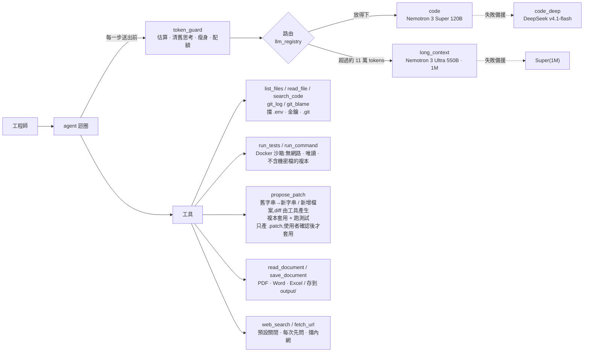

# 對內研發助理 — NVIDIA NIM 多模型 Agent

企業內部的程式碼助理(找 bug、提修正、寫技術文件)。考量程式碼隱私,不接雲端 Claude / GPT,
改走 NVIDIA 生態系:開發期接 API Catalog(build.nvidia.com),正式環境換成地端 NIM 容器,**程式碼不用改**。

重點不在「接上了模型」,而在:**依任務與 token 數動態切換模型、控制 token 與顯存、讓 agent 只能在沙箱裡動手**,
而且每個設計都用真模型實測過。實測與審查抓到 19 個問題,見下方。

## 架構



| 檔案 | 內容 |
|---|---|
| `models.yaml` | 模型註冊表。換模型、換 catalog / 地端都只改這裡 |
| `llm_registry.py` | 依角色建模型、備援鏈、依 token 數路由 |
| `agent.py` | agent 迴圈:每步送出前清舊思考 → 瘦身 → 放不下就升級模型 → 檢查配額;`AgentSession` 支援多輪互動 |
| `token_guard.py` | token 估算(實測校準)、截斷、歷史瘦身、大檔大綱、每人配額 |
| `tools.py` | 列檔 / 讀檔 / 搜尋 / git 紀錄 / 沙箱測試與指令 / 提 patch / 存文件,含機密檔封鎖 |
| `documents.py` | PDF / Word / Excel 轉文字,給 `read_document` 和 `@附檔` 用 |
| `web.py` | 上網搜尋(Tavily)與讀網頁;`.env` 設 `ALLOW_WEB=true` 才啟用,每次上網都先問使用者 |
| `smoke_test.py` | 對 catalog 上每個模型做冒煙測試(回應、思考開關、tool calling) |

## 實測結果(2026-10-06,NVIDIA API Catalog 免費層)

| 路徑 | 情境 | 結果 |
|---|---|---|
| 模型冒煙測試 | 三顆模型 × 回應 / 開思考 / 關思考 / tool calling | 全過;Super 每次 0.4–2.6 秒,DeepSeek 18–27 秒 |
| 改 bug | `demo_workspace/`:加號寫成減號 | Super 7 步、1.6 萬 tokens;兩次 diff 格式錯被退回後自行修正,沙箱實測 2 passed,原檔未動 |
| 長文本 | 客服專案 57 個檔案、19.1 萬 tokens,寫整份技術文件 | 自動升級到 Ultra,1 步完成,**482 秒**;抽查 14 處 `path:line` 引用全對 → [`demo_output/helpdesk-tech-doc.md`](demo_output/helpdesk-tech-doc.md) |
| 離線測試 | 假模型,不需金鑰 | 56 個全過 |

## 實測與審查抓到的 19 個問題

| # | 問題 | 怎麼發現 | 處理 |
|---|---|---|---|
| 1 | 指定的 `deepseek-v3`、`qwen2.5-coder-32b` 已從 catalog 下架 | 逐一探測 API 端點 | 改用現役版本;Qwen 標為只能地端 |
| 2 | `ChatNVIDIA` 預設輸出上限只有 1024 tokens,寫程式會被截斷 | 讀套件原始碼 | 每個角色明確設定 |
| 3 | 套件會把推理內容原樣回送伺服器,多輪對話會滾雪球 | 讀套件原始碼 | 每步清掉上一輪以前的推理;同一輪(單次任務)內保留,模型接著 tool call 推理需要,改由 token 預算控管 |
| 4 | Ultra 收到 `force_nonempty_content` 會把推理混進回答 | 冒煙測試 + 對照實驗 | Ultra 不送此參數;另清除孤立的 `</think>` |
| 5 | DeepSeek 連一句話都要 20 秒 | 冒煙測試計時 | 日常主腦改 Super,DeepSeek 留給難題 |
| 6 | agent 無法驗證自己的修正,最後**自己編了測試結果** | 端到端實測 | `propose_patch` 改在複本上套用並跑測試、回傳真實結果 |
| 7 | `.env` 裡的工作目錄設定被忽略 | 準備實測時 | 讀完 `.env` 再設定工具 |
| 8 | `read_file` 擋不住 `.env`,金鑰可能被送出去 | 指向真實專案前檢查 | 封鎖 `.env`、金鑰、憑證、`.git/` |
| 9 | 檔案已全附上,模型仍分段重讀,每步重送 18 萬 tokens | 長文本實測 | 整檔模式不給工具 |
| 10 | token 估算低估約 20%(估 15.3 萬,實際 18.3 萬) | 長文本實測 | 公式重新校準;執行中依實際用量自動修正 |
| 11 | 配額只在開始時檢查,跑到一半可遠超額度 | 長文本實測 | 每一步都檢查 |
| 12 | 工具定義(約 700 tokens)沒算進估算,被誤判成估算偏低,之後每步 ×1.99,中型任務會提早升級到 Ultra | 改 bug 實測 log(10/8) | 工具定義算進估算,不拿來放大倍率 |
| 13 | 模型回的 tool call 參數不是合法 JSON 時,被當成最終答案、回傳空字串 | 程式碼審查 + 讀套件原始碼 | 錯誤回給模型修正重送 |
| 14 | 模型手寫 unified diff 常格式錯,每次被退回多花 2–3 步(10/8 一次 8 步、2.1 萬 tokens) | 改 bug 實測 | 改成給「舊字串 → 新字串」,diff 由工具產生;同一題變 4 步、8 千 tokens |
| 15 | `models.yaml` 的上下文長度是 catalog 的值(Ultra 1M),地端預設 256K;切到 nim 時路由以為放得下,送出才被拒 | 程式碼審查 | 角色可另寫 `nim_context_window`,`LLM_BACKEND=nim` 時自動套用 |
| 16 | `search_code` 會跟著 symlink / Windows junction 讀到工作區外的檔案(`read_file` 有擋) | 程式碼審查 + 本機重現(一般帳號就能建 junction) | 依實際位置檢查,工作區外與機密檔一律略過 |
| 17 | 「修 bug + 新增回歸測試檔」時,模型以為 patch 會疊加,先單獨修 bug、再單獨送測試檔,測試失敗多繞好幾步(11 步、4.8 萬 tokens) | 新增檔案實測(10/9) | 工具回傳時明確提醒每個 patch 單獨驗證;同一題重跑變 7 步、2.2 萬 tokens |
| 18 | `run_tests` 直接掛載整個工作區,`.env` 在沙箱裡讀得到;複本的排除清單也漏了 `.env.staging` 這類檔名 | 加 `run_command` 前審查 | 沙箱一律掛排除機密檔的複本,判斷跟 `read_file` 同一套;指到工作區外的連結也不複製 |
| 19 | 沙箱逾時只停掉 docker CLI,容器在背景繼續跑;Windows 上沙箱輸出的中文變亂碼 | 程式碼審查 + 本機實測 | 容器加名字、逾時就 `docker kill`;輸出一律用 UTF-8 解碼 |

## 執行

```bash
python -m venv .venv && .venv/Scripts/pip install -r requirements.txt
cp .env.example .env                              # 填 NVIDIA_API_KEY,AGENT_WORKSPACE 指向要分析的 repo
docker build -t dev-assistant-sandbox sandbox     # 測試沙箱(含 pytest)
.venv/Scripts/python agent.py                     # 互動模式:一直聊下去,記得前面的內容;@calc.py 附檔、/clear 新對話
                                                  # 修改通過沙箱測試後會問要不要套用,回答 y 才改工作區
.venv/Scripts/python agent.py "test_add 失敗了,找出 bug 並提出修正" -f calc.py
.venv/Scripts/python agent.py "為這個專案寫技術文件" -f a.py -f b.py --whole   # 整檔 → 自動走長文本模型
.venv/Scripts/python agent.py "這個 race condition 的根因" -f x.py --role code_deep --think on
.venv/Scripts/python -m pytest -q                 # 離線測試,不需金鑰
```

## 還沒做 / 限制

- **地端 NIM 沒實際部署過**:需要 GPU 伺服器。Ultra 550B 要 8×B200/H200 等級,建議第一階段用 Super 120B(FP8 約 2×H100)。
- 配額是記憶體版,多台 API server 要換 Redis;長任務(如整份文件 8 分鐘)應走背景佇列。
- 模型清單會汰換,上線前用 `ChatNVIDIA.get_available_models()` 或 `smoke_test.py` 再對一次。
- `requirements.txt` 鎖在實測過的版本:程式依賴 langchain-nvidia-ai-endpoints 的內部行為,升版前先跑離線測試和 `smoke_test.py`。
- 地端的 `nim_context_window`(Ultra / Super 備援 256K)是規劃值,部署時 `NIM_MAX_MODEL_LEN` 要設成一樣。
- 上網工具擋內網是「連線前解析一次 DNS」,擋不住 DNS rebinding;正式環境要走有白名單的出口 proxy。搜尋關鍵字和網址會送到外部網站,公司環境要先確認規定。
- **PoC 不要送公司真實程式碼到 build.nvidia.com**:API Trial 條款 §1.2 禁止正式使用,§3.3 允許 NVIDIA 收集輸入輸出改進模型。

---

HSUAN
