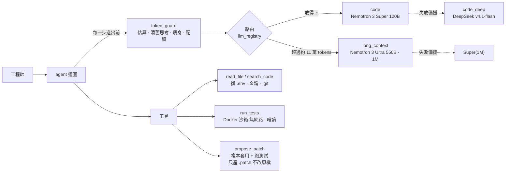

# 對內研發助理 — NVIDIA NIM 多模型 Agent

企業內部的程式碼助理(找 bug、提修正、寫技術文件)。考量程式碼隱私,不接雲端 Claude / GPT,
改走 NVIDIA 生態系:開發期接 API Catalog(build.nvidia.com),正式環境換成地端 NIM 容器,**程式碼不用改**。

重點不在「接上了模型」,而在:**依任務與 token 數動態切換模型、控制 token 與顯存、讓 agent 只能在沙箱裡動手**,
而且每個設計都用真模型實測過。實測過程抓到 11 個問題,見下方。

## 架構



| 檔案 | 內容 |
|---|---|
| `models.yaml` | 模型註冊表。換模型、換 catalog / 地端都只改這裡 |
| `llm_registry.py` | 依角色建模型、備援鏈、依 token 數路由 |
| `agent.py` | agent 迴圈:每步送出前清舊思考 → 瘦身 → 放不下就升級模型 → 檢查配額 |
| `token_guard.py` | token 估算(實測校準)、截斷、歷史瘦身、大檔大綱、每人配額 |
| `tools.py` | 讀檔 / 搜尋 / 沙箱測試 / 提 patch,含機密檔封鎖 |
| `smoke_test.py` | 對 catalog 上每個模型做冒煙測試(回應、思考開關、tool calling) |

## 實測結果(2026-10-06,NVIDIA API Catalog 免費層)

| 路徑 | 情境 | 結果 |
|---|---|---|
| 模型冒煙測試 | 三顆模型 × 回應 / 開思考 / 關思考 / tool calling | 全過;Super 每次 0.4–2.6 秒,DeepSeek 18–27 秒 |
| 改 bug | `demo_workspace/`:加號寫成減號 | Super 7 步、1.6 萬 tokens;兩次 diff 格式錯被退回後自行修正,沙箱實測 2 passed,原檔未動 |
| 長文本 | 客服專案 57 個檔案、19.1 萬 tokens,寫整份技術文件 | 自動升級到 Ultra,1 步完成,**482 秒**;抽查 14 處 `path:line` 引用全對 → [`demo_output/helpdesk-tech-doc.md`](demo_output/helpdesk-tech-doc.md) |
| 離線測試 | 假模型,不需金鑰 | 102 個全過 |

## 實測抓到的 11 個問題

| # | 問題 | 怎麼發現 | 處理 |
|---|---|---|---|
| 1 | 指定的 `deepseek-v3`、`qwen2.5-coder-32b` 已從 catalog 下架 | 逐一探測 API 端點 | 改用現役版本;Qwen 標為只能地端 |
| 2 | `ChatNVIDIA` 預設輸出上限只有 1024 tokens,寫程式會被截斷 | 讀套件原始碼 | 每個角色明確設定 |
| 3 | 套件會把推理內容原樣回送伺服器,多步 agent 會滾雪球 | 讀套件原始碼 | 每步清掉上一輪以前的推理 |
| 4 | Ultra 收到 `force_nonempty_content` 會把推理混進回答 | 冒煙測試 + 對照實驗 | Ultra 不送此參數;另清除孤立的 `</think>` |
| 5 | DeepSeek 連一句話都要 20 秒 | 冒煙測試計時 | 日常主腦改 Super,DeepSeek 留給難題 |
| 6 | agent 無法驗證自己的修正,最後**自己編了測試結果** | 端到端實測 | `propose_patch` 改在複本上套用並跑測試、回傳真實結果 |
| 7 | `.env` 裡的工作目錄設定被忽略 | 準備實測時 | 讀完 `.env` 再設定工具 |
| 8 | `read_file` 擋不住 `.env`,金鑰可能被送出去 | 指向真實專案前檢查 | 封鎖 `.env`、金鑰、憑證、`.git/` |
| 9 | 檔案已全附上,模型仍分段重讀,每步重送 18 萬 tokens | 長文本實測 | 整檔模式不給工具 |
| 10 | token 估算低估約 20%(估 15.3 萬,實際 18.3 萬) | 長文本實測 | 公式重新校準;執行中依實際用量自動修正 |
| 11 | 配額只在開始時檢查,跑到一半可遠超額度 | 長文本實測 | 每一步都檢查 |

## 執行

```bash
python -m venv .venv && .venv/Scripts/pip install -r requirements.txt
cp .env.example .env                              # 填 NVIDIA_API_KEY,AGENT_WORKSPACE 指向要分析的 repo
docker build -t dev-assistant-sandbox sandbox     # 測試沙箱(含 pytest)
.venv/Scripts/python agent.py "test_add 失敗了,找出 bug 並提出修正" -f calc.py
.venv/Scripts/python agent.py "為這個專案寫技術文件" -f a.py -f b.py --whole   # 整檔 → 自動走長文本模型
.venv/Scripts/python agent.py "這個 race condition 的根因" -f x.py --role code_deep --think on
.venv/Scripts/python -m pytest -q                 # 離線測試,不需金鑰
```

## 網頁版

```bash
.venv/Scripts/python -m web                       # 在專案根目錄執行,打開 http://127.0.0.1:8765
```

- 類 ChatGPT / Claude 的對話介面:左側紀錄、中間對話串(可收合的「工作過程」即時顯示每一步)、底部輸入框、長文件開在右側欄;可以追問。
- 可選資料夾寫在 `workspaces.yaml`;也可以上傳 zip 或檔案(20 MB / 2000 檔 / 單檔 2 MB 上限,24 小時後刪除;
  `.env`、金鑰、`.git` 會被丟掉,路徑穿越與符號連結整包拒收)。
- 對話與每一步的紀錄存在 `conversations/`,重新整理或伺服器重開都看得到;跑到一半被關掉的會標成「已中斷」。
- 只聽本機 `127.0.0.1`、只接受本機網址,沒有登入;網頁不修改任何專案檔案,修正只存成 `.agent_patches/*.patch`,
  頁面上提供 `git apply` 指令讓工程師自己套用(patch 存檔前先整理成相對於資料夾的格式,驗證與套用結果一致)。

2026-10-08 在瀏覽器用真模型實測(Nemotron 3 Super):demo 專案「找 bug → 追問」兩輪都在沙箱驗證通過
(8 步 15.6 秒、5 步 22 秒),追問還自己找到 `average([])` 除以零;重新整理後完整還原、停止鍵在第 1 步後停下;
客服專案整份文件模式預估 100 檔約 44.6 萬 tokens → Ultra。實測也抓到第 12 個問題:`propose_patch` 用 `rstrip()`
把 diff 最後一行「只有空白」的 context 刪掉,模型給的正確修正被判 corrupt patch、白白浪費 3 步,已修正並加回歸測試。

## 還沒做 / 限制

- **地端 NIM 沒實際部署過**:需要 GPU 伺服器。Ultra 550B 要 8×B200/H200 等級,建議第一階段用 Super 120B(FP8 約 2×H100)。
- 配額是記憶體版,多台 API server 要換 Redis;長任務(如整份文件 8 分鐘)應走背景佇列。
- 模型清單會汰換,上線前用 `ChatNVIDIA.get_available_models()` 或 `smoke_test.py` 再對一次。
- **PoC 不要送公司真實程式碼到 build.nvidia.com**:API Trial 條款 §1.2 禁止正式使用,§3.3 允許 NVIDIA 收集輸入輸出改進模型。

---

HSUAN
