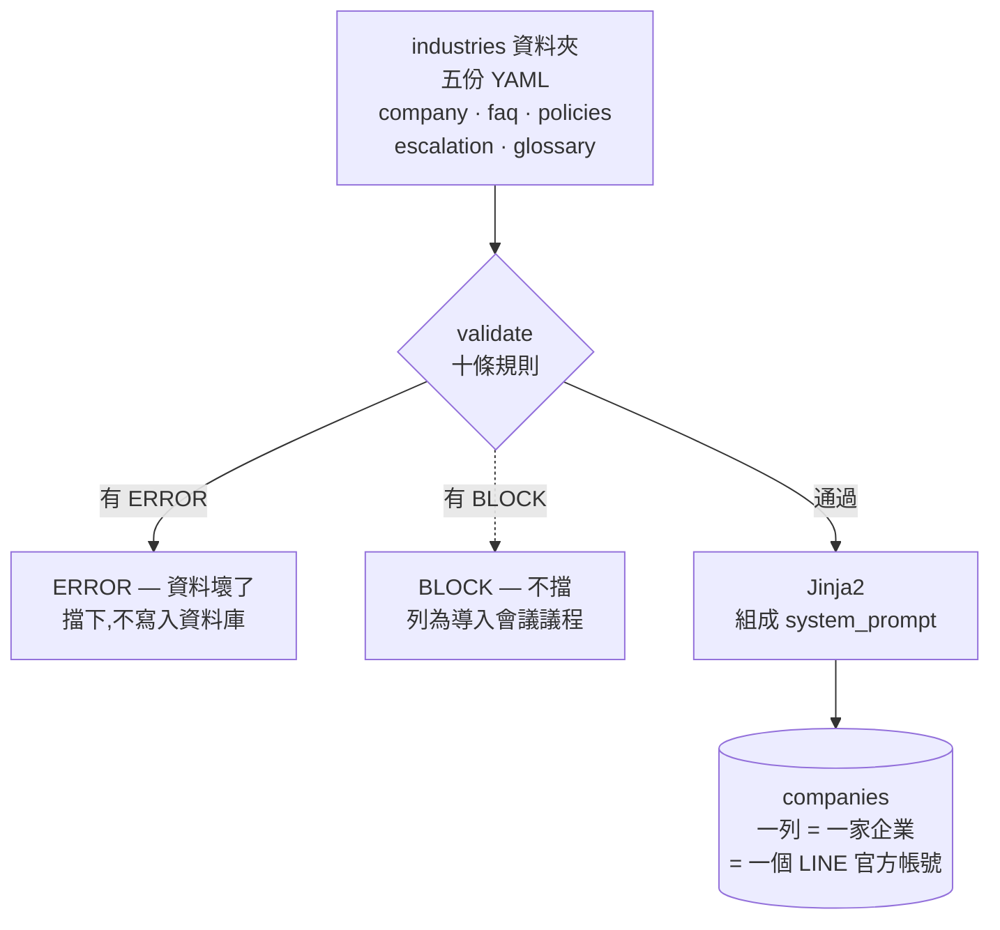
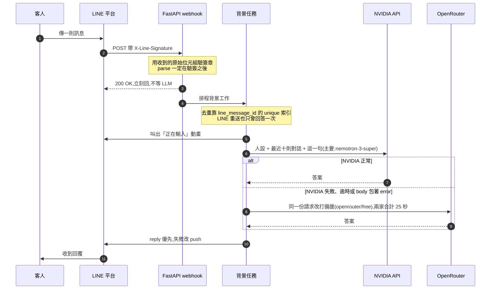

# AI 智慧客服(萬用) 技術文件  

以下文件依照「系統概觀、架構與元件、主要流程、資料模型、設定與部署、已知限制與風險」六個章節敘述，並以 **path:line** 的形式標註依據。所有敘述均來自提供的原始檔案，未做任何臆測。

---

## 1 系統概觀  

- 本系統的核心主張是「**換行業只換資料**」：行業是參數，不是寫死的程式碼（README.md:90‑92）。  
- 交付的不是機器人，而是一份「**導入檢查清單**」；`validate` 產出的每一條 BLOCK 都是導入會議上要與客戶確認的議題，不是 bug（README.md:93‑94）。  
- **沉默是唯一不被接受的失敗模式**：LLM 掛了、網路斷了、token 過期時，客人仍必須收到一句得體的話（README.md:95‑96）。  
- 技術棧包括 FastAPI、SQLAlchemy、PostgreSQL/SQLite、Alembic、LINE Messaging API、NVIDIA API、OpenRouter（README.md:99‑100）。  

---

## 2 架構與元件  

### 2.1 導入時資料流程（離線階段）  

來源：README.md:22‑36。

### 2.2 執行時每則訊息的流程（線上階段）  

來源：README.md:40‑66。

### 2.3 主要程式元件  

| 元件 | 責任 | 參考路徑 |
|------|------|----------|
| **FastAPI 入口** | 建立應用、掛載 webhook 路由、健康檢查 | `app/main.py:1‑52` |
| **資料庫層** | 建立 Engine、Session、Base、事件聽覺（SQLite 外鍵） | `app/database.py:1‑76` |
| **ORM 模型** | `Company`、`User`、`ChatHistory`、`KnowledgeDocument` | `app/models/company.py:1‑92`，`app/models/user.py:1‑77`，`app/models/chat.py:1‑89`，`app/models/knowledge.py:1‑83` |
| **加密工具** | Fernet 對稱加解密 LINE 憑證 | `app/crypto.py:1‑32` |
| **設定管理** | Pydantic Settings，讀取 `.env`、提供預設值（LLM、速率限制等） | `app/config.py:1‑65` |
| **LINE 客戶端** | `reply`、`push`、`show_loading`、`mark_as_read`、`send`（reply 優先） | `app/line/client.py:1‑128` |
| **簽章驗證** | 使用原始位元組計算 HMAC‑SHA256 | `app/line/signature.py:1‑26` |
| **知識載入** | 讀取五份 YAML、`load_industry` | `app/knowledge/loader.py:1‑26` |
| **系統 Prompt 生成** | Jinja2 模板 `system.j2`，`StrictUndefined` 防止 silenzious 失敗 | `app/knowledge/render.py:1‑23` |
| **資料驗證** | 十條規則（ERROR / BLOCK） | `app/knowledge/validate.py:1‑129` |
| **Agent / LLM 呼叫** | 完整的上游重試邏輯、工具呼叫解析、token 統計、latency 累計 | `app/agent/llm.py:1‑218` |
| **Prompt 組裝** | `build_messages`（system + history + user） | `app/agent/prompt.py:1‑14` |
| **簡繁轉換** | OpenCC s2t，僅轉字不改詞 | `app/agent/zh.py:1‑54` |
| **轉真人邏輯** | 關鍵字層、`match_keyword`；工具層、`build_tool`、`decision_from_tool`；安全網（念腳本、口頭承諾） | `app/agent/handoff.py:1‑191` |
| **速率限制** | 三層限制（個人/分鐘、個人/天、全站/分鐘），判定函式 `check`、`reply_text` | `app/ratelimit.py:1‑171` |
| **Webhook 路由** | 同步驗簽、立刻回 200、背景任務 `process_text_event`（去重、人機模式、關鍵字、速率限制、LLM、轉真人、回覆） | `app/routers/webhook.py:1‑387` |
| **CLI** | `validate`、`seed`、`set-webhook`、`release`、`list` | `app/cli.py:1‑374` |
| **Alembic 遷移** | 版本控制、資料表結構變更（如新增 `escalation_rules`、`staff_notify_to`、`contact`、`ix_chat_created`） | `alembic/versions/*`（見 `tests/test_alembic.py`） |

---

## 3 主要流程（訊息進來到回覆、轉真人、速率限制）  

以下依照 `app/routers/webhook.py` 的實作說明，並標註關鍵程式行號。

1. **收到原始位元組**  
   ```python
   raw = await request.body()                     # line 57
   ```
2. **依 slug 查公司、解密 channel_secret**  
   ```python
   company = db.scalar(select(Company).where(Company.slug == slug))   # line 60
   channel_secret = decrypt(company.line_channel_secret_enc)          # line 64
   ```
3. **驗簽章**（必須用原始位元組）  
   ```python
   if not verify_signature(channel_secret, raw,
                           request.headers.get("X-Line-Signature")):
       raise HTTPException(status_code=401, detail="bad signature")   # line 68‑70
   ```
4. **解析 JSON**（此時才 parse）  
   ```python
   body = json.loads(raw)                                             # line 74‑76
   ```
5. **目的地交叉比對**（防止 A 公司的 webhook 被 B 公司的 token 操作）  
   ```python
   destination = body.get("destination")
   if expected_destination and destination and destination != expected_destination:
       raise HTTPException(status_code=401, detail="destination mismatch")   # line 79‑81
   ```
6. **立刻回 200 OK**（背景任務才開始處理）  
   ```python
   return {"status": "ok"}                                            # line 109
   ```
7. **背景任務 `process_text_event`**（在 `BackgroundTasks` 中執行）  
   - **寫入使用者訊息**（去重由資料庫 unique 索引負責）  
     ```python
     incoming = ChatHistory(company_id=company_id, user_id=user.id,
                            role=ChatRole.USER,
                            content=text if message_type == "text" else _label(message_type),
                            line_message_id=line_message_id)          # line 142‑145
     db.add(incoming)                                                 # line 146
     try: db.flush()                                                 # line 147‑148
     except IntegrityError:                                            # line 149‑151
         # 重送直接略過
     ```
   - **排除店員帳號**（不當客人訊息）  
     ```python
     if company.staff_notify_to and line_user_id == company.staff_notify_to:
         logger.info("%s 是店員帳號,不當客人訊息處理", line_user_id)   # line 158‑160
         return
     ```
   - **人機模式（HUMAN）檢查**  
     ```python
     if user.mode == ConversationMode.HUMAN:
         if is_still_human(user, now):
             logger.info("客人 %s 由真人接手中,AI 不回", line_user_id)   # line 166‑170
             return
         return_to_ai(user, now)                                     # line 171‑172
     ```
   - **非文字訊息固定回覆**（不走 LLM）  
     ```python
     if message_type != "text":
         db.add(ChatHistory(..., content=NON_TEXT_REPLY))            # line 177‑179
         client.send(reply_token, line_user_id, NON_TEXT_REPLY)      # line 180
         _mark_read(client, mark_as_read_token)                     # line 181‑182
         return
     ```
   - **速率限制檢查**（在呼叫 LLM 前）  
     ```python
     verdict = ratelimit.check(db, user_pk=user_pk, now=now,
                               limits=ratelimit.Limits.from_settings(settings))   # line 197‑198
     if verdict.action is not ratelimit.Action.ALLOW:
         reply = ratelimit.reply_text(verdict, company.contact)    # line 203
         if reply is None:                                          # line 204‑206
             return
         db.add(ChatHistory(..., role=ChatRole.ASSISTANT, content=reply))   # line 208‑209
         client.send(reply_token, line_user_id, reply)              # line 210
         _mark_read(client, mark_as_read_token)                    # line 211‑212
         return
     ```
   - **取最近 N 則歷史（排除剛剛寫入的這筆）**  
     ```python
     rows = db.scalars(
         select(ChatHistory)
         .where(ChatHistory.user_id == user_pk,
                ChatHistory.id != incoming.id)
         .order_by(ChatHistory.id.desc())
         .limit(settings.history_limit)
     ).all()                                                          # line 216‑222
     ```
   - **組成 `messages`**（將之前轉真人的腳本標記為 `RECITED_HISTORY_MARKER`，避免模型學會念腳本）  
     ```python
     history = [
         {"role": "assistant" if r.role in (ChatRole.ASSISTANT,
                                            ChatRole.HUMAN_AGENT) else "user",
          "content": (RECITED_HISTORY_MARKER
                      if r.role == ChatRole.ASSISTANT
                      and is_handoff_script(rules, r.content)
                      else r.content)}
         for r in reversed(rows)
     ]                                                                # line 223‑235
     ```
   - **呼叫 LLM**（可能帶工具）  
     ```python
     tool = build_tool(rules)                                          # line 259
     result = complete(build_messages(system_prompt, history, text),
                       tools=[tool] if tool else None)                # line 261‑263
     ```
   - **LLM 失敗時使用 fallback 訊息**  
     ```python
     except LLMError as exc:
         logger.warning("LLM 失敗,改送 fallback:%s", exc)           # line 264‑266
         answer, tokens, latency = fallback, None, None            # line 267
     ```
   - **Agent 層：模型呼叫工具**  
     ```python
     if result is not None and result.tool_call is not None:
         _handoff(decision=decision_from_tool(rules, result.tool_call.arguments),
                  **handoff_args)                                   # line 271‑274
         return
     ```
   - **安全網 1：模型念出腳本（未呼叫工具）**  
     ```python
     recited = decision_from_recited_script(rules, result.text)      # line 280‑283
     if recited is not None:
         _handoff(decision=recited, **handoff_args)
         return
     ```
   - **安全網 2：模型口頭說要轉接但未呼叫工具**  
     ```python
     promised = decision_from_promised_transfer(result.text)        # line 287‑290
     if promised is not None:
         _handoff(decision=promised, **handoff_args)
         return
     ```
   - **只有模型真的回了答案才加「專員不在線上」前綴（適用於過期 HUMAN）**  
     ```python
     if result is not None:
         answer = expired_prefix + answer                           # line 294
     ```
   - **簡繁兜底、長度截斷**  
     ```python
     answer = ensure_traditional(answer)                           # line 298
     answer = truncate_for_line(answer, settings.line_max_text_length)   # line 299
     ```
   - **寫入助理訊息（含 token、latency）**  
     ```python
     with session_scope() as db:
         db.add(ChatHistory(company_id=company_id, user_id=user_pk,
                            role=ChatRole.ASSISTANT, content=answer,
                            token_count=tokens, latency_ms=latency))   # line 301‑305
     ```
   - **發送給 LINE（reply 優先，失敗改 push）**  
     ```python
     client.send(reply_token, line_user_id, answer)                # line 306
     _mark_read(client, mark_as_read_token)                       # line 307‑310
     ```
   - **例外捕獲：最後防線 fallback**（避免沉默）  
     ```python
     except Exception:
         logger.exception("背景處理爆炸,嘗試送出 fallback")       # line 311‑314
         _send_last_resort_fallback(company_id, line_user_id, reply_token)   # line 315
     ```

> **關鍵點**：  
> - 關鍵字轉真人 **不受速率限制** （`process_text_event` 中關鍵字判斷在速率限制之前，見行 192‑194）。  
> - 轉真人後，**AI 不再回覆**，僅留訊息給真人（見 `is_still_human`、`return_to_ai` 的使用）。  
> - 速率限制只擋「要打模型」的路徑；固定回覆與關鍵字轉真人直接送出（見 `process_text_event` 中的非文字分支與關鍵字分支皆在速率限制前返回）。  

---

## 4 資料模型  

| 模型 | 主要欄位與設計決策 | 參考路徑 |
|------|-------------------|----------|
| **Company** | - `id`：UUID 存 `String(36)`（決策 8）<br>- `slug`：唯一 webhook 路徑 `/webhook/{slug}`（決策 2）<br>- `line_channel_secret_enc`、`line_channel_token_enc`：`LargeBinary`，Fernet 加密（決策 3）<br>- `line_destination`：儲存 bot 自身 `userId`，用來交叉比對（決策 2）<br>- `system_prompt`：seed 時一次性寫入（與 escalation_rules 同步）<br>- `escalation_rules`：JSON，儲存完整 escalation.yaml（規則層與工具定義皆從此讀）<br>- `staff_notify_to`：可為 NULL，用來推播給店員<br>- `human_mode_timeout_minutes`：HUMAN 模式逾時自動回到 AI（決策 4）<br>- `vector_collection`：一家一個 collection（決策 7）<br>- `is_active`：軟刪除標誌 | `app/models/company.py:1‑92` |
| **User** | - `id`：`String(36)` UUID<br>- `company_id` + `line_user_id` 組合唯一鍵（決策 1）<br>- `mode`：`ConversationMode`（AI / HUMAN），使用 `native_enum=False`、`values_callable` 存 `.value`（決策 8）<br>- `mode_expires_at`：HUMAN 模式自動歸還的期限（決策 4）<br>- `mode_changed_at`：記錄最近一次切換時間<br>- `display_name`、`picture_url`：來自 LINE profile（可能為 NULL） | `app/models/user.py:1‑77` |
| **ChatHistory** | - `id`：自增整數（只有此表用自增，其餘為 UUID）<br>- `company_id`、`user_id`：外鍵<br>- `role`：`ChatRole`（USER / ASSISTANT / SYSTEM / HUMAN_AGENT），`native_enum=False` <br>- `content`：訊息內容（非文字訊息會以標籤如 `[圖片]`、`[貼圖]` 儲存）<br>- `line_message_id`：唯一索引 `uq_chat_line_message_id`，用來去重 LINE 重送（決策 6）<br>- `latency_ms`、`token_count`：觀測用<br>- `created_at`：`DateTime(timezone=True)`，一律存 UTC（決策 8） | `app/models/chat.py:1‑89` |
| **KnowledgeDocument** | - `id`：`String(36)` UUID<br>- `company_id`：外鍵<br>- `filename`、`source_type`、`source_uri`、`checksum`（SHA256）<br>- `vector_collection`：與公司對應的 collection<br>- `chunk_count`、`embedding_model`：用於向量庫管理<br>- `status`：`DocumentStatus`（PENDING/INDEXING/READY/FAILED），`native_enum=False` <br>- `error_message`、`indexed_at`：失敗資訊 | `app/models/knowledge.py:1‑83` |

> **租戶隔離**：`Company.id` 與 `User.company_id`、`ChatHistory.company_id` 透過外鍵形成多租戶；向量庫採「一家一個 collection」而非共用 collection + `company_id` 過濾，避免誤把別家的文件回給客人（見 `app/models/company.py` 決策 7 說明與 `app/models/knowledge.py` 欄位 `vector_collection`）。

---

## 5 設定與部署  

### 5.1 設定 (`app/config.py`)  

- 資料庫預設 `sqlite:///./helpdesk.db`，可透過環境變數 `DATABASE_URL` 覆寫（第 14 行）。  
- Fernet 金鑰 `fernet_key`（必填），用於加解密 LINE 憑證（第 17 行）。  
- LLM 設定：  
  - 主要模型：`openrouter_model`（預設 `openrouter/free`）  
  - 備援模型：`openrouter_fallback_model`（預設 `nvidia/nemotron-3-super-120b-a12b:free`）  
  - 若設定 `nvidia_api_key` 則 NVIDIA 成為主要、OpenRouter 成為備援（第 20‑34 行）。  
  - `llm_timeout_seconds` 單次請求上限（第 35 行）。  
  - `llm_total_budget_seconds` 兩個模型合計上限（第 40 行），設計為 25 秒以留餘裕給 LINE reply token 的一分鐘效期。  
  - `llm_max_tokens` 單次回覆上限（第 41 行）。  
- 速率限制（第 47‑52 行）：  
  - `rate_limit_user_per_minute`（預設 5）  
  - `rate_limit_user_per_day`（預設 20）  
  - `rate_limit_global_per_minute`（預設 30）  
- 其他：`history_limit`（最近 N 則對話，預設 10），`line_max_text_length`（LINE 訊息長度上限，預設 5000）。  
- 所有字串在載入時會自動去除前後空白（`_strip` 驗證器，第 54‑59 行）。  

### 5.2 Docker Compose 部署（見 README.md）  

- 三個容器：  
  1. `app`：FastAPI 應用，啟動時自動執行 `alembic upgrade head`（見 `docker-entrypoint.sh` 說明）  
  2. `db`：`postgres:17-alpine`，資料持久化於 `pgdata` volume  
  3. `ngrok`：提供固定對外 HTTPS 網址（需在 `.env` 填入 `NGROK_AUTHTOKEN`）  
- `docker compose up -d` 即可啟動全部服務（README.md:104‑111）。  
- 首次部署後仍需：  
  - 到 ngrok 儀表板取得固定網域並填入 `.env` 的 `NGROK_AUTHTOKEN`（README.md:115‑116）  
  - 勾選 Docker Desktop → Settings → General → “Start Docker Desktop when you sign in to your computer”（README.md:118‑121）  
  - 將固定網址寫入 LINE Console（一次性指令）：  
    ```bash
    docker compose exec app python -m app.cli set-webhook --slug bistro --url https://<your-domain>.ngrok-free.dev
    ```  
    （README.md:124‑126）  

### 5.3 開發機流程（不需 Docker）  

```bash
pip install -e ".[dev]"
python scripts/dev.py --slug bistro   # 起服務 + Tunnel，並自動寫回 LINE Console
```
（README.md:141‑145）  

### 5.4 資料遷移（SQLite → PostgreSQL）  

- 使用 `scripts/migrate_sqlite_to_postgres.py` 進行一次性搬遷，會把 `Naive datetime` 標記為 UTC（見 `tests/test_migrate.py:44‑50`），並推進序列以避免 `chat_histories.id` 衝突（見同檔案：184‑220）。  
- 遷移前需先 `docker compose up -d` 建好空表，再跑遷移腳本（見 `docs/superpowers/specs/2026-09-22-deploy-design.md:243‑251`）。  

---

## 6 已知限制與風險  

以下內容節錄自 `docs/report.md`（限制章節）與真實環境踩到的坑章節，並以 **path:line** 標註。

### 6.1 目前會直接出事的限制  

| 限制 | 說明 | 參考 |
|------|------|------|
| **電腦沒開就連不到** | 服務仍在本機筆電上，依賴本機開機狀態（設計上可接受） | `docs/report.md:392‑394` |
| **「卡住但沒退出」不會自動處理** | `restart: unless-stopped` 只在容器退出時生效，連線池耗盡等狀況不會自動復原 | `docs/report.md:395‑397` |
| **`restart: unless-stopped` 不涵蓋人手動停掉** | `docker stop` / `docker kill` 會讓容器保持停止狀態，不會自動拉回（設計上尊重人工決策） | `docs/report.md:398‑404` |
| **ngrok 免費層硬上限** | 每月 20,000 requests、1GB 流量，超過會斷線且錯誤不會指向「額度用完」 | `docs/report.md:413‑416` |

### 6.2 速率限制的已知取捨  

- 個人每分鐘 5 次、每天 20 次（算 AI 回覆），全站每分鐘 30 次。  
- 計數直接來自 `chat_histories`，部署與重啟不會歸零，多 worker 也適用（`docs/superpowers/specs/2026-10-05-rate-limit-design.md:44‑45`）。  
- 「只提醒一次」透過檢查提醒訊息是否已經寫入紀錄來決定，避免依賴剛好剛好等於門檻（同檔:46‑47）。  
- 全站忙碌時會回覆「目前詢問的人比較多，請過幾分鐘再傳一次;急的話可以直接聯繫 {contact}」（同檔:118‑119）。  
- 關鍵字轉真人 **不受限流影響**（同檔:24‑25）。  
- 測試策略見 `tests/test_ratelimit.py`（驗證個人/分鐘、個人/天、全站行為）。  

### 6.3 模型品質與轉真人判斷的不穩定  

- 免費模型供應商滿載是常態，會導致模型失敗或空回覆；系統已實作重試機制（NVIDIA → OpenRouter → fallback），但免費模型的工具呼叫成功率仍有波動（真機 5 次只有 3 次真的呼叫工具） → 因而保留關鍵字層與兩道安全網（念腳本、口頭承諾）作為底線（`docs/report.md:423‑429`）。  
- 模型嘴上說「我將為您轉接」但未呼叫工具的情況，已加入兩道安全網：  
  1. 念出規則腳本（`decision_from_recited_script`）  
  2. 口頭說要轉接但未呼叫工具（`decision_from_promised_transfer`）  
  若觸發則直接使用店家審過的通用句 `GENERIC_SCRIPT`，避免將模型可能夾帶的醫療建議送給客人（`docs/report.md:334‑349`、`tests/test_handoff.py:799‑819`）。  

### 6.4 其他已知限制  

- **知識庫塞在 prompt 裡**：每則請求實際使用 1500‑2300 tokens，僅適合十數筆 FAQ；大規模知識庫必須改用 RAG（`docs/report.md:435‑436`）。  
- **只有一個工具**（transfer_to_human），無法直接執行訂位、查詢訂單等狀態性操作（`docs/report.md:437‑438`）。  
- **多租戶目前僅在 schema 層面**：實際只有一列公司資料，但表結構已支援多租戶（`docs/report.md:439‑440`）。  
- **真人接管缺少介面**：真人客服直接使用 LINE 官方帳號後台聊天功能，系統無法紀錄真人說話或即時更新 HUMAN 模式逾時（`docs/report.md:441‑443`）。  
- **同一位客人在模型思考的 25 秒內連傳兩則**：第一則轉真人後，第二則的回答仍可能被送出（`docs/report.md:444‑445`）。  

### 6.5 已在文件中標註的工程面問題  

- `LineClient` 每則訊息都會建立新的 `httpx.Client` 且不關閉（`docs/report.md:449`）。  
- `scripts/dev.py` 的通訊埠硬寫為 8000，可能與其他服務衝突（`docs/report.md:450`）。  
- log 僅輸出至終端機，關掉後即無法取得（`docs/report.md:451`）。  

---

## 結語  

本系統的設計圍繞 **「換行業只換資料」**、**「導入檢查清單」**、**「絕不沉默」** 三個核心主張，採用分層架構（資料驗證 → Jinja2 生成 system_prompt → 資料庫儲存 → FastAPI webhook → 背景任務處理），並嚴格遵守以下關鍵決策：

1. **Webhook 收到即回 200**，真正工作交給背景任務，避免 LINE 重送導致重複回覆（README.md:50‑52）。  
2. **簽章必須用原始位元組計算**，防止 Pydantic body model 造成位元組變簽章失敗（README.md:54‑59）。  
3. **去重交給資料庫的 unique 索引**（`line_message_id`），避免 race condition（README.md:61‑65）。  
4. **LINE 憑證加密存**（Fernet），避免明文洩露帶來帳號被接管的風險（README.md:66‑70）。  
5. **轉真人分層**：關鍵字層保底（不問模型） + 模型工具層（agent）+ 兩道安全網（念腳本、口頭承諾），確保安全攸關的路徑不只靠模型（`docs/superpowers/specs/2026-09-24-agent-handoff-design.md:71‑86`）。  
6. **速率限制只擋要打模型的路徑**，關鍵字轉真人與固定回覆完全不受限流，同時提供個人/天提醒與全站忙碌訊息（`docs/superpowers/specs/2026-10-05-rate-limit-design.md:20‑28`）。  

所有上述行為皆有對應的程式碼或設定檔做依據，方便在實際開發、部署與除錯時快速追蹤。祝開發順利！

— long_context · 1 步 · 191,076 tokens
